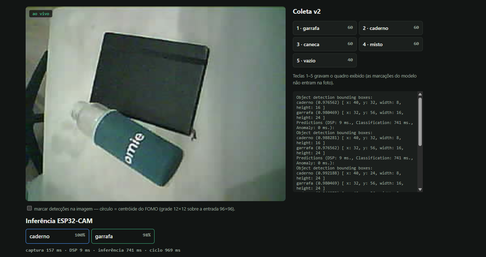

# Detecção de objetos com ESP32-CAM + Edge Impulse (FIAP IoT)

Modelo de **detecção de objetos FOMO** treinado no Edge Impulse com fotos tiradas pela própria
ESP32-CAM, exportado como biblioteca Arduino e rodando **embarcado e offline** na placa. Detecta
`garrafa`, `caderno` e `caneca` a ~1 quadro por segundo.

> Enunciado: *usando a plataforma Edge Impulse, utilizar uma das duas trilhas de treinamento (áudio ou
> imagem), treinar um modelo, exportá-lo para ESP32 e implantá-lo — ESP32-CAM para a trilha de imagem.*

| | |
|---|---|
| Trilha | Imagem — detecção de objetos (FOMO), com *bounding boxes* |
| Modelo final | RGB 96×96 (squash) → FOMO MobileNetV2 0.35, **int8**, 100 epochs |
| Dataset final (v2) | 285 fotos 320×240 da própria placa; 227 treino / 58 teste |
| Teste (Edge Impulse) | **F1 0,92** (P 0,90 / R 0,95) — o v1 tinha 0,89 |
| Ao vivo na placa | **56 de 57 tentativas certas**; inferência 741 ms, ciclo 924 ms |
| Implantação | firmware sem WiFi; imagem e detecções pela serial → viewer no navegador |
| Edge Impulse (público) | <https://studio.edgeimpulse.com/public/1149980/latest> — dataset, boxes, impulse e modelo |



---

## 1. Hardware

- ESP32-CAM clone AI-Thinker (ESP32-D0WD-V3, câmera OV2640, 4 MB de PSRAM).
- Adaptador USB-serial FT232R: `TX→U0R`, `RX→U0T`, `5V`, `GND`
  ([diagrama](docs/wiring/ligacao-esp32cam.html)).
- Gravar: jumper **IO0↔GND** + RST. Rodar: tirar o jumper + RST (a placa não tem auto-reset).

## 2. Pipeline

```
OV2640 (JPEG 320×240) ──► squash 96×96 RGB ──► FOMO int8 (TFLite, arena na PSRAM) ──► centróides
        │                                                                                │
        └──── #FRAME <base64> ──────────── serial 460800 ──────────── #DET <json> ◄──────┘
                                              │
                                     viewer.py → http://localhost:8001
```

O FOMO não devolve caixas: ele classifica cada célula de uma grade 12×12 sobre a entrada 96×96 e
devolve o **centróide** de cada objeto. É o que o torna leve o bastante para um microcontrolador.

## 3. Como o modelo chegou aqui

O registro completo, etapa por etapa, com os comandos e as evidências, está em
[`docs/processo.md`](docs/processo.md). Resumo:

| Etapa | O que aconteceu | Evidência |
|---|---|---|
| Coleta v1 | 201 fotos 640×480 tiradas pela placa (firmware com `/capture` via WiFi), objetos **segurados na mão** | `docs/img/02-dataset.png` |
| Rotulagem v1 | boxes desenhadas à mão no Studio; conferência pela API achou 1 box espúria | `docs/img/01-labeling.png` |
| Treino 1 | grayscale: F1 0,56, caderno 0% (objetos escuros sem textura se confundem com o fundo) | `docs/img/03`, `04` |
| Treino 2 | **RGB**: F1 de teste int8 0,89, float32 0,85 | `docs/img/05`–`08` |
| Firmware | squash idêntico ao treino, protocolo `#FRAME`/`#DET`, vazamento de memória do exemplo corrigido | `firmware/esp32_camera/` |
| int8 × float32 | na placa: int8 **741 ms**, float32 4939 ms; int8 venceu em precisão e velocidade | `processo.md`, Etapa 5 |
| Otimização | tentar a arena na RAM interna: impossível (maior bloco livre 110 KB < 154 KB) | `processo.md`, Etapa 6 |
| **Viés da mão** | ao vivo, a mão atrapalhava: estava em todo exemplo positivo e em nenhum negativo | `processo.md`, Etapa 7 |
| Coleta v2 | 289 fotos **com os objetos na mesa**, 320×240 (a mesma imagem que o modelo vê na placa) | `docs/img/09-dataset-v2.png` |
| Rotulagem v2 | regra "mão sempre fora da box"; boxes assistidas (ver abaixo) | `docs/img/rotulagem-v2/` |
| Retreino v2 | mesmos hiperparâmetros; **F1 de teste int8 0,92** | `docs/img/10`, `10b`, `11` |
| Teste A/B | v1 e v2 gravados na mesma placa, mesma cena: o v1 erra onde o v2 acerta | `docs/img/ao-vivo/` |

**Rotulagem assistida (v2).** No v1 todas as boxes foram desenhadas à mão. No v2, parte foi marcada no
Studio com sugestões do YOLOv5 revisadas uma a uma, e o restante foi marcado pela API do Edge Impulse
com revisão visual foto a foto e conferência final por folhas de contato
(`docs/img/rotulagem-v2/`, geradas por `tools/folhas_rotulagem.py`). O Edge Impulse registra a autoria
de cada box (usuário × chave de API).

## 4. Resultados

Detalhes, tabelas por tentativa e protocolo em [`docs/resultados.md`](docs/resultados.md).

**Edge Impulse (int8):** validação F1 0,94; teste F1 **0,92** (54/58). Por classe na validação:
caderno 0,97, caneca 0,96, garrafa 0,88.

**Na placa (2.351 ciclos medidos):** inferência 741 ms (determinística), captura 157 ms, ciclo
924 ms. A quantização int8 é o que viabiliza o modelo: a RAM de pico estimada cai de 415 KB (float32)
para 133 KB.

**Validação ao vivo (cena de treino, sem a mão):**

| Cena | Acertos |
|---|---|
| garrafa / caderno / caneca | 10/10 cada |
| misto, três objetos | 7/8 |
| misto, pares | 9/9 |
| vazio (mesa sem objetos) | 10/10, nenhum falso positivo |

Os dois erros observados são o mesmo: a **garrafa vista de ponta** (fundo ou gargalo) lida como caneca.

**v1 × v2 na mesma cena (garrafa + caderno):** o v1 detecta a garrafa, inventa uma caneca (63–66%) e
perde o caderno; o v2 dá garrafa 98–100% e caderno 97–100%, sem nada a mais.

## 5. Limitações

- Treino, teste e validação usam **uma única cena** (mesa, luz e objetos). Não há medida de
  generalização para outro fundo, outra luz ou objetos parecidos.
- Confusão residual **garrafa → caneca** quando a garrafa aparece de ponta.
- **~1 quadro/s**: serve para cenas paradas ou lentas.
- O FOMO devolve centróides; um objeto grande pode gerar dois, então não é um contador confiável.
- A validação ao vivo tem 57 tentativas montadas à mão: amostra pequena e não aleatória.

## 6. Como reproduzir

**Só rodar o modelo numa ESP32-CAM:** siga [`docs/gravar-na-sua-placa.md`](docs/gravar-na-sua-placa.md)
(um arquivo, `release/fiap-esp32cam-fomo-v2-merged.bin`, gravado em 0x0).

**Compilar o firmware:**

```bash
arduino-cli core install esp32:esp32@2.0.17
arduino-cli lib install --zip-path ei-fiap-iot-esp32cam-arduino-1.0.3-int8.zip   # export do Edge Impulse
arduino-cli compile --fqbn esp32:esp32:esp32cam:PartitionScheme=huge_app firmware/esp32_camera --output-dir build
arduino-cli upload  -p COM3 --fqbn esp32:esp32:esp32cam:PartitionScheme=huge_app --input-dir build
```

**Viewer e testes** (Python 3.11):

```bash
pip install -r requirements.txt
python viewer.py --port COM3          # http://localhost:8001
python -m pytest -q                   # 58 testes
```

## 7. Estrutura do repositório

| Caminho | Conteúdo |
|---|---|
| `firmware/esp32_camera/` | firmware de inferência (mudanças sobre o exemplo marcadas `FIAP`) |
| `viewer.py` | viewer da serial no navegador; também foi a tela da coleta v2 e da validação |
| `collect.py`, `collector_ui.py` | coleta v1 pelo WiFi (firmware VisionGuard) |
| `tools/` | conferência de rótulos e folhas de rotulagem (API do Edge Impulse), avaliação da validação |
| `tests/` | testes automatizados (pytest) |
| `validacao/` | as 57 tentativas da validação ao vivo (`.jpg` + `.json` com as detecções) |
| `release/` | firmware em arquivo único para gravar em outra placa |
| `docs/processo.md` | registro do processo (base deste relatório) |
| `docs/resultados.md` | números da validação |
| `docs/img/` | prints do Edge Impulse e do viewer |
